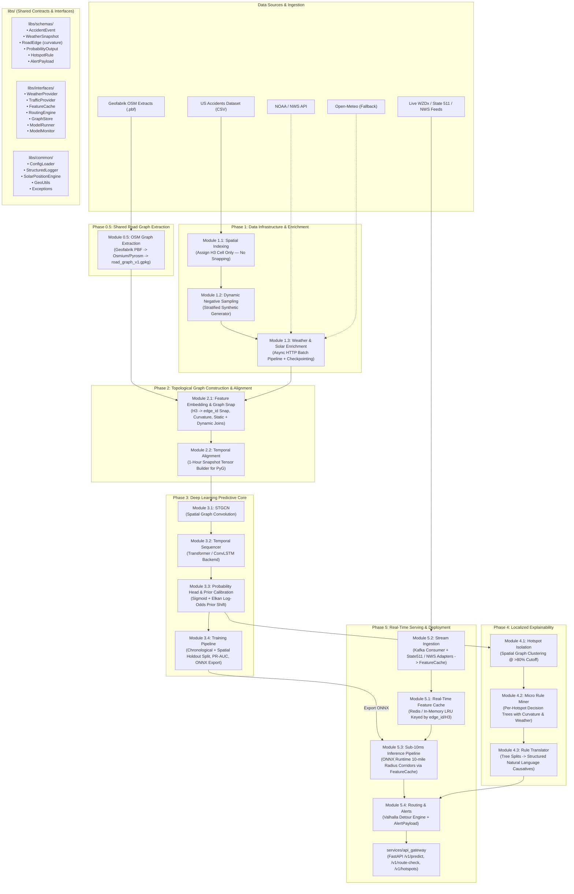

# US Road Accident Prediction & Explainability Platform

A production-grade, modular, spatio-temporal road accident prediction and explainability platform built on clean architecture, interface-driven contracts, and separation of concerns.

Predicts short-horizon (next 1-hour) accident probabilities per road segment, isolates dangerous spatial hotspot clusters (>80% risk cutoff), mines localized micro decision trees to generate human-readable causative rules, and provides real-time vehicle routing hazard interception with automated safe detours.

---

## 1. System Architecture



---

## 2. Architectural Principles & Patches Applied

| Patch | Architectural Resolution | Implementation Details |
|---|---|---|
| **Patch 1** | **Circular Dependency Resolved** | In Phase 1, `spatial_indexing` assigns `h3_cell` only. **Phase 0.5** (`osm_graph_extraction`) is promoted to run first, producing `road_graph_v1.gpkg`. Snapping `h3_cell -> edge_id` is executed in Phase 2 `feature_embedding`. |
| **Patch 2** | **Leak-Free Temporal Splitting** | `training/temporal_split.py` enforces chronological time cutoffs (`train <= 2021`, `val 2022`, `test 2023`) and a 15% geographic H3 spatial holdout check. |
| **Patch 3** | **Offline OSM PBF Processing** | Geofabrik `.pbf` parsing via `pyrosm`/`osmium` for regional extraction; `OverpassDebugAdapter` is gated strictly for ad-hoc debugging. |
| **Patch 4** | **Sampling Bias Prior Calibration** | `probability_head/calibration.py` implements **Elkan's log-odds prior shift formula** correcting for 3.5:1 synthetic training bias down to real-world base rate. |
| **Patch 5** | **Road Curvature & Sinuosity** | `feature_embedding` derives geometric turning-angle variance and sinuosity ratio, adding `curvature: float` to `RoadEdge` for Phase 4 explainability. |
| **Patch 6** | **Low-Latency Feature Cache** | `libs/interfaces/feature_cache.py` with `InMemoryLRUFeatureCache` and `RedisFeatureCache`. Stream ingestion updates cache; serving queries cache directly for sub-10ms inference. |
| **Patch 7** | **State 511 TrafficProvider** | `State511Adapter` streams live incident and road condition GeoJSON feeds into `FeatureCache`. |
| **Patch 8** | **Model Monitoring & Retraining** | `libs/interfaces/model_monitor.py` for logging prediction vs outcome, PSI drift computation, and quarterly retraining lifecycle. |
| **Patch 9** | **CI/CD, DVC & Gateway Auth** | Added `.github/workflows/ci.yml`, `dvc.yaml`, and production authentication guidelines in `services/api_gateway/README.md`. |

---

## 3. Directory Layout

```
accident-prediction-platform/
├── README.md
├── docker-compose.yml          # Multi-container orchestration (PostGIS, Redis, Kafka, API)
├── Makefile                    # Standard developer automation targets
├── pyproject.toml              # Build metadata & dependency declarations
├── dvc.yaml                    # DVC pipeline and artifact tracking (Patch 9)
├── .env.example
├── .github/workflows/ci.yml    # CI test & lint workflow (Patch 9)
├── configs/
│   ├── base.yaml               # Master application config & provider bindings
│   ├── h3_grid.yaml            # H3 spatial indexing resolution (res 8)
│   ├── model.yaml              # STGCN, Transformer/ConvLSTM architectures & split dates
│   ├── thresholds.yaml         # Hotspot cutoff (0.80), sampling ratio (3.5:1)
│   └── logging.yaml            # Structured logging config
│
├── libs/                       # Shared zero-business-logic contracts and utilities
│   ├── schemas/                # Pydantic v2 schemas: AccidentEvent, WeatherSnapshot, RoadEdge, etc.
│   ├── interfaces/             # Abstract Base Classes: WeatherProvider, TrafficProvider, FeatureCache, etc.
│   └── common/                 # ConfigLoader, StructuredLogger, SolarEngine, GeoUtils, Exceptions
│
├── modules/
│   ├── phase0_5_graph_extraction/  # Offline PBF road graph extractor (Patch 1 & 3)
│   ├── phase1_data_infra/          # H3 indexing (no snapping), negative sampling, async weather
│   ├── phase2_graph_construction/  # Curvature embedding, graph snap join, 1-hr PyG tensor alignment
│   ├── phase3_predictive_core/     # STGCN + Transformer/ConvLSTM + Elkan prior calibration
│   ├── phase4_explainability/      # Hotspot isolation (>80%) + localized micro decision tree mining
│   └── phase5_realtime_service/    # FeatureCache, State 511 streams, ONNX runner, Valhalla routing
│
├── services/
│   ├── api_gateway/                # FastAPI application exposing /v1/predict, /v1/route-check, /v1/hotspots
│   └── worker/                     # Standalone background streaming ingestion consumer
│
├── infra/
│   ├── postgis/                    # Spatial database schema (init.sql)
│   ├── docker/                     # Dockerfiles for API Gateway and Worker
│   └── kafka/                      # Topic definitions (topics.json)
│
├── scripts/                        # Standalone CLI tools for each phase
│   ├── run_phase0_5_graph_build.py
│   ├── run_phase1_enrichment.py
│   ├── run_phase2_feature_embed.py
│   ├── run_phase3_train.py
│   ├── run_phase4_explain.py
│   └── run_phase5_live_demo.py
│
└── tests/                          # Complete automated test suite
```

---

## 4. Quickstart Guide

### 1. Run the Full Test Suite
```bash
make test
```
Or via Python's standard test runner:
```bash
python -m unittest discover -s tests/unit -p "test_*.py"
python -m unittest discover -s modules/phase0_5_graph_extraction/tests -p "test_*.py"
python -m unittest discover -s modules/phase1_data_infra/tests -p "test_*.py"
python -m unittest discover -s modules/phase2_graph_construction/tests -p "test_*.py"
python -m unittest discover -s modules/phase3_predictive_core/tests -p "test_*.py"
python -m unittest discover -s modules/phase4_explainability/tests -p "test_*.py"
python -m unittest discover -s modules/phase5_realtime_service/tests -p "test_*.py"
python -m unittest discover -s services/api_gateway/tests -p "test_*.py"
```

### 2. Run the Live End-to-End Demo Simulation
```bash
python scripts/run_phase5_live_demo.py
```
This executes:
1. Ingesting topological road network corridor.
2. Streaming adverse atmospheric telemetry into `FeatureCache`.
3. Executing sub-10ms forward pass with `RealTimeInferencePipeline`.
4. Isolating danger hotspots and translating micro decision tree splits into natural-language causative statements.
5. Evaluating a vehicle trip, intercepting dangerous segments, and calculating an alternate detour payload.

### 3. Launch Docker Compose Stack
```bash
make dev-up
```
Spins up PostGIS (`5432`), Redis (`6379`), Redpanda Kafka (`19092`), Valhalla (`8002`), and the API Gateway (`8000`).

### 4. Start API Gateway
```bash
uvicorn services.api_gateway.main:app --host 0.0.0.0 --port 8000 --reload
```
Interactive Swagger documentation is available at `http://localhost:8000/docs`.

---

## 5. API Reference & Payloads

### POST `/v1/predict`
Calculates calibrated next 1-hour accident probability for road segments.
```json
{
  "prediction_id": "pred_a1b2c3d4",
  "forecast_timestamp": "2026-08-18T14:30:00Z",
  "num_edges_evaluated": 48,
  "num_hotspots_detected": 2,
  "inference_latency_ms": 4.82,
  "edge_predictions": [
    {
      "edge_id": "1_2_1000",
      "timestamp": "2026-08-18T14:30:00Z",
      "risk_score": 0.864,
      "risk_band": "severe",
      "is_hotspot": true,
      "contributing_features": {
        "precipitation_mm": 12.5,
        "visibility_km": 2.0,
        "traffic_density": 0.92
      }
    }
  ]
}
```

### POST `/v1/route-check`
Evaluates navigation paths and returns hazard warnings with safe detour options.
```json
{
  "route_id": "trip_user_123",
  "overall_safety_status": "HAZARDOUS",
  "max_risk_score": 0.864,
  "active_alerts": [
    {
      "alert_id": "alert_9f8e7d6c",
      "hotspot_cluster_id": "hotspot_cluster_1",
      "hazard_location": { "latitude": 37.7749, "longitude": -122.4194, "sequence_order": 0 },
      "max_risk_probability": 0.864,
      "explanation": {
        "summary": "Severe Hydroplaning & Blinding Sun-Glare Hazard",
        "causative_statement": "Accident probability elevated to 86.4% across 2 road segments primarily driven by heavy rainfall, combined with sharp road curvature.",
        "driver_advisory": "Reduce speed by 15-20 mph and increase following distance to 4+ seconds.",
        "confidence_score": 0.92
      },
      "suggested_detour": {
        "detour_id": "detour_2_avoid",
        "risk_reduction_pct": 76.8,
        "additional_distance_km": 1.8,
        "additional_time_minutes": 3.5,
        "geometry_polyline": "LINESTRING (-122.4194 37.7749, -122.395 37.7989)"
      }
    }
  ],
  "recommended_route_geometry": "LINESTRING (-122.4194 37.7749, -122.395 37.7989)"
}
```
